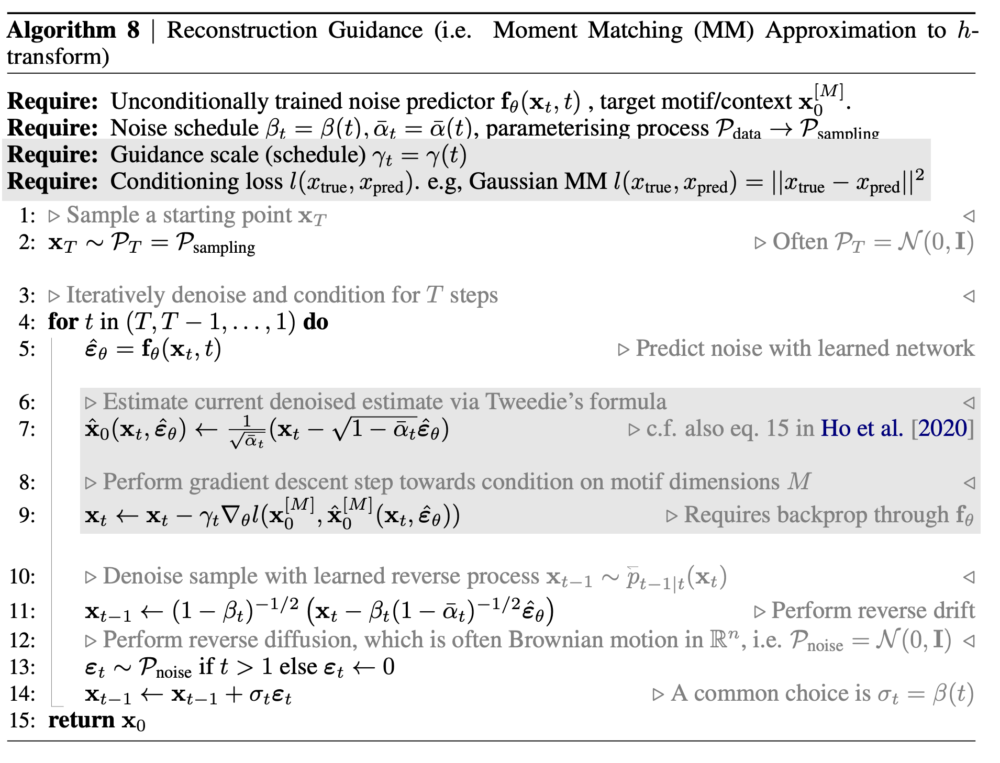
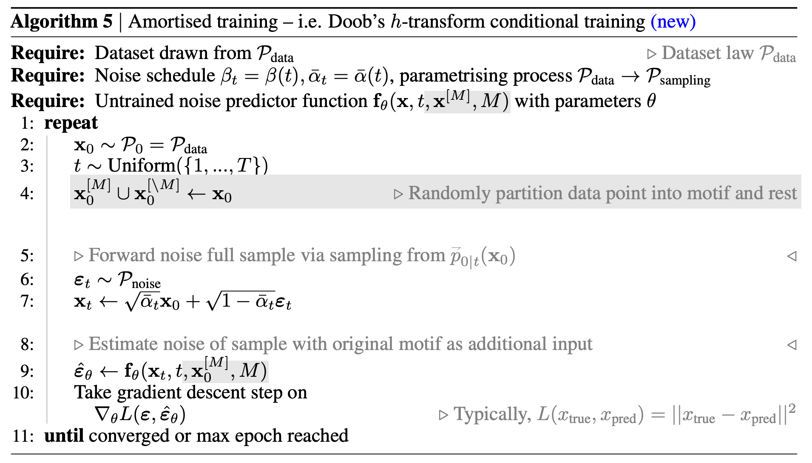
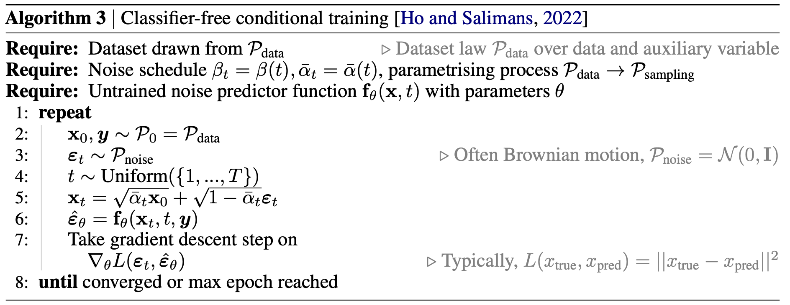

# Lesson 3 - Conditioning in SDEs

### Optional reading for this lesson
- [Särkkä & Solin - Applied Stochastic Differential Equations](https://github.com/AaltoML/SDE), chapter 6

### [Slides](/assets/slides/sde-course-lec3.pdf)

#### Video (soon)

## 1. Conditioning - Doob's h-transform

We saw in the last lecture that we can use the reverse SDE to generate samples from a score-based model. If we train this score-based model well eough, these samples should be indistinguishable from the true data distribution. However, in practical applications such as image generation or molecule design, we not want to generate *any* sample from the data distribution, but we want to generate samples that satisfy certain conditions. For example, we might want to generate an image of a cat, or we might want to generate a molecule that has a certain property. How can we do this?

### 1.1 Formalising conditioning

Let us again formalise this problem in the SDE framework. We have a forward SDE that describes the evolution of the data distribution to the noise distribution:

$$dX_t = f^+(X_t, t)dt + \sigma(X_t,t)dW_t$$

We can then use the reverse SDE to generate samples from the noise distribution.

$$
\begin{align}
dX_t &= f^-(X_t, t)dt + \sigma(X_t,t)d\bar{W}_t \\
     &= [-f^+(X_t, t) + \sigma^2(X_t) \nabla_x log p(X_t)]dt + \sigma(X_t)d\bar{W}_t
\end{align}
$$

However, we want to generate samples from the data distribution that satisfy certain conditions. Generally, we want to satisfy so-called *endpoint* or *hitting point* conditions, meaning that we want the SDE to hit a certain point $$x_T$$ at time $$T$$ (the end of the denoising process). In other words, given a *hard constraint* in the form of a point $$x_T = z$$ or a constraint set $$x_T \in B$$, we want to find a new SDE with $$p(x_T = z) = 1$$ or $$p(x_T \in B) = 1$$. When we do such a conditioning, we will see that this conditioned process is again an SDE, but with a different drift term. To indicate the difference, we will use the notation $$f^+_{cond}$$ for the conditioned drift term in case we condition a forward SDE and $$f^-_{cond}$$ for the conditioned drift term in case we condition a reverse SDE. We will also call the random variable in the conditioned SDE $$Z_t$$ instead of $$X_t$$.

> Definition: Given a forward SDE $$dX_t = f^+(X_t, t)dt + \sigma dW_t$$ and a hard constraint $$x_T = z$$, the conditioned forward SDE is given by
{:.lead}

$$
\begin{align}
dZ_t &= f^+_{cond}(Z_t, t)dt + \sigma dW_t \\
     &= [f^+(Z_t, t) + \sigma^2 \nabla_{Z_t}p^h_{T \mid t}(z \mid Z_t)]dt + \sigma dW_t
\end{align}
$$

> where $$Z_T \sim \delta_z \text{ and } p^h_{T \mid t}(z \mid Z_t) =  p^h_{T \mid t}(z_T = z \mid Z_t)$$  is called the *h-transform*.
{:.lead}

This result is known as the *Doob's h-transform* and is relevant in generative modelling since different conditioning methods can be seen as different approximations to this quantity. 

### 1.2 Example for pinned Brownian motion

Let us look at a simple example to understand this better in the context of generative modelling. We will look at the example of pinned Brownian motion, where we want to generate a Brownian motion that hits a certain point $$z$$ at time $$T$$, i.e. $$Z_T \sim \delta_0$$. Let us fix this point to be $$z = 0$$. Our Brownian motion starts from an arbitrary distribution $$X_0 \sim p_{data}(x)$$ and evolves according to the SDE $$dX_t = \sigma dW_t$$. Applying Doob's h-transform, we get

$$
\begin{align}
dZ_t &= f^+_{cond}(Z_t, t)dt + \sigma dW_t \\
     &= - \frac{Z_t}{T-t} dt + \sigma dW_t
\end{align}
$$

## 2. Conditioning in score-based models

With this background, we can look at how conditioning is done in score-based models and how this fits in the framework of Doob's h-transform.

Similar to how diffusion models in practice were established before people made the connection to SDEs, conditioning in score-based models was also used before the connection to Doob's h-transform was made. However, the connection provides some cool insights into how conditioning works in score-based models and how we can improve it. For more background information and some applications you can read [this paper we recently published on this](https://arxiv.org/abs/2312.09236).

### 2.1 Conditioning at Inference Time

Let us consider the time reversed SDE $$dX_t = f^{-}(X_t) dt + \sigma_t d\tilde{W}_t$$ and the general hard constraint $$(X_0 \in B)$$ ($$X_0$$ since we consider the endpoint of a reversed SDE running from $$T$$ to $$0$$). We can then use Doob's h-transform to get the conditioned SDE:

$$
\begin{align}
dZ_t &= f^-_{cond}(Z_t)dt + \sigma_t d\tilde{W}_t \\
	 &= [f^-(Z_t) + \sigma^2 \nabla_{Z_t}p^h_{0 \mid t}(X_0 \in B \mid Z_t)]dt + \sigma_t d\tilde{W}_t
\end{align}
$$

The h-transform can now be decomposed into two terms via Bayes rule (see [this video, minute 44:00](https://youtube.com/watch?v=DvUAiqTCMAg)):

$$\nabla_{X_t} \ln p^h_{0 \mid t}(X_0 \in B \mid Z_t) = \nabla_{X_t} \ln p_{t \mid 0}(Z_t \mid X_0 \in B) - \nabla_{X_t} \ln p_{t}(Z_t)$$

Here, the first term (conditional score) ensures that the event is hit at the specified boundary time, while the second term (prior score) ensures it is still the time-reversal of the correct forward process.

The hard constraint $$X_0 \in B$$ is often also expressed as $$\mathcal{A}(X_0) = y$$, where $$\mathcal{A}$$ is a known *measurement operator* and $$y$$ an observation. In this case, the conditioned SDE can be written as 

$$
\begin{align}
dZ_t &= f^-_{cond}(Z_t)dt + \sigma_t d\tilde{W}_t \\
	 &= [f^-(Z_t) + \sigma^2 \nabla_{Z_t}p^h_{0 \mid t}(\mathcal{A}(X_0) = y \mid Z_t)]dt + \sigma_t d\tilde{W}_t
\end{align}
$$

It is just a notational difference, and depending on the task you consider one formulation may be more natural than the other. For example, in computer vision tasks such as image reconstruction, the measurement operator is often a blurring or other noising operator, so the second formulation is more natural. In other tasks, such as molecule design, the first formulation is more natural since our constraints are often based on substructures of the molecule (we will discuss this later in more detail).

So can we just sample from Doob's h-transform to get samples that satisfy our constraints? Unfortunately, this is not possible. To see why, let us re-express the h-transform:

$$ p^h_{0 \mid t}(\mathcal{A}(X_0) = y \mid Z_t) = \int \mathbb{1}_{\mathcal{A}(x_0) = y} p_{0 \mid t}(x_0 \mid Z_t) dx_0$$

where $$\mathbb{1}_{\mathcal{A}(x_0) = y}$$ is the indicator function that is 1 if the constraint is satisfied and 0 otherwise. In the case of score-based models, $$p_{0 \mid t}(X_0 \mid Z_t)$$ is exactly the transition density of our reversed SDE as seen before. While we can sample for this distribution, we cannot easily get its value at a certain point, making the integral above hard to evaluate. 

One way around this was proposed by [Song et al. 2022](https://arxiv.org/abs/2206.00364), [Finzi et al. 2023](https://arxiv.org/abs/2302.10130), [Rozet & Louppe 2023](https://arxiv.org/abs/2302.10130) and others: use a Gaussian approximation to the transition density term:

$$p_{0 \mid t}(x_0 \mid Z_t) \approx \mathcal{N}(x_0 \mid \mu_{0 \mid t}(Z_t), \gamma_t I)$$

where $$\mu_{0 \mid t}(Z_t) = \mathbb{E}[X_0 \mid X_t = Z_t]$$ is the mean of the Gaussian approximation and corresponds to the denoised sample, which we can estimate using the already trained score network. The variance $$\gamma_t$$ is the variance of the Gaussian approximation and is a hyperparameter that has to be tuned. 

This Gaussian approximation allows us to evaluate the h-transform integral. Specifically, for a measurement operator $$\mathcal{A}$$ and observation $$y$$, we can approximate:

$$p^h_{0 \mid t}(\mathcal{A}(X_0) = y \mid Z_t) \approx \int \mathbb{1}_{\mathcal{A}(x_0) = y} \mathcal{N}(x_0 \mid \mu_{0 \mid t}(Z_t), \gamma_t I) dx_0$$

For linear measurement operators $$\mathcal{A}(x) = Ax$$, this integral can often be computed in closed form. For example, if $$\mathcal{A}$$ is a linear projection, the constraint becomes a linear constraint on the Gaussian, which can be handled using standard Gaussian conditioning formulas.

With this approximation plugged into our conditioned SDE, we get the following approximate conditioned SDE:

$$
\begin{align}
dZ_t &= f^-_{cond}(Z_t)dt + \sigma_t d\tilde{W}_t \\
	 &= [f^-(Z_t) + \sigma_t^2 \nabla_{Z_t} \ln p^h_{0 \mid t}(\mathcal{A}(X_0) = y \mid Z_t)]dt + \sigma_t d\tilde{W}_t \\
	 &\approx [f^-(Z_t) + \sigma_t^2 \nabla_{Z_t} \left\lVert y - \mathcal{A}(\mu_{0 \mid t}(Z_t)) \right\rVert^2_{\gamma_t^{-1}}]dt + \sigma_t d\tilde{W}_t
\end{align}
$$

where the last line uses the Gaussian approximation and the fact that for a Gaussian constraint, the log-probability gradient is proportional to the squared error weighted by the inverse covariance.

Approaches using this approximation are generally called *reconstruction guidance*. Why is this? Let us look at the algorithm that implements this approximation:

The lines in grey are the ones that differ from the standard unconditional sampling algorithm. 

Conditioning at inference time has the big advantage that one can just use a pre-trained unconditional model for sampling and does not need to train a separate model for conditioning. However, in some settings it has been shown thta choosing the guidance scale and thereby balancing between sample quality and fulfillment of the constraint is not trivial, leading to subpar results.

### 2.2 Conditioning at Training Time

Instead of enforcing the constraint during inference time, we can also learn the whole conditional score including the h-transform directly at training time. Since during training we amortise over all the constraints for each specific sample, this approach is often called *amortised training*. More specifically, our network approximating the conditional  score is amortised over measurement operator $$\mathcal{A}$$ and observations $$y$$ instead of learning a separate network for each condition.

> Proposition: Given the objective
{:.lead}

$$f^* = \argmin_{f} \mathbb{E}_{Y \sim p(y \mid \mathcal{A}, x_0), \mathcal{A} \sim p, X_0 \sim p_{data}}\big[ \int_0^T \left\lVert f(t,X_t, Y, \mathcal{A}) - \nabla_{X_t} \ln p_{t \mid 0}(X_t \mid X_0) \right\rVert^2 dt \big]$$

> the minimiser is given by the conditional score 
{:.lead}

$$f^*(t,X_t, y, A) = \nabla_{X_t} \ln p_{t \mid 0}(X_t \mid Y = y, \mathcal{A} = A)$$

We can proof this by invoking the mean squared error property of the conditional expectation we discussed before in the context of the closed-form transition densities for score-based models. This property tells us that the minimiser of the objective is given by:

$$
\begin{align}
f(x_t, y, A) &= \mathbb{E}_{X_0 \mid X_t=x_t, Y = y, \mathcal{A} = A}[\nabla_{X_t} \ln p_{t \mid 0}(X_t \mid X_0)] \hspace{10px} \mid \text{expectation def.} \\
&= \int \nabla_{x_t} \ln p_{t \mid 0}(x_t \mid X_0) p_{0 \mid t}(X_0 \mid x_t, y, A) dX_0 \hspace{10px} \mid \text{Bayes} \\
&= \int \nabla_{x_t} \ln p_{t \mid 0}(x_t \mid X_0) \frac{p_{t \mid 0}(x_t \mid X_0) p_{0}(X_0)}{p_{t}(x_t \mid y, A)} dX_0 \hspace{10px} \mid \text{log. deriv. trick} \\
&= \int \frac{\nabla_{x_t}  p_{t \mid 0}(x_t \mid X_0)}{p_{t \mid 0}(x_t \mid X_0)} \frac{p_{t \mid 0}(x_t \mid X_0) p_{0}(X_0)}{p_{t}(x_t \mid y, A)} dX_0 \hspace{10px} \mid \text{pull out denominator} \\
&= \frac{1}{p_{t}(x_t \mid y, A)} \int \frac{\nabla_{x_t}  p_{t \mid 0}(x_t \mid X_0)}{p_{t \mid 0}(x_t \mid X_0)} p_{t \mid 0}(x_t \mid X_0) p_{0}(X_0) dX_0 \hspace{10px} \mid \text{cancel terms} \\
&= \frac{1}{p_{t}(x_t \mid y, A)} \int \nabla_{x_t} [p_{t \mid 0}(x_t \mid X_0)] p_{t}(x_t \mid y, A) dX_0 \hspace{10px} \mid \text{dom. conv. theorem} \\
&= \frac{1}{p_{t}(x_t \mid y, A)} \nabla_{x_t}  \int [p_{t \mid 0}(x_t \mid X_0)] p_{t}(x_t \mid y, A) dX_0 \hspace{10px} \mid \text{marginalise over integral} \\
&= \frac{1}{p_{t}(x_t \mid y, A)} \nabla_{x_t}  p_{t}(x_t \mid y, A) \hspace{10px} \mid \text{log deriv. trick} \\
&= \nabla_{x_t} \ln p_{t}(x_t \mid y, A)
\end{align}
$$

So we can see that the minimiser of the objective is indeed the conditional score. This means that we can train the conditional score by minimising the objective above. Let's look at a practical algorithm that does this:

With these results in mind, we can look at some of the conditioning methods that have been proposed for score-based models before the connection to SDEs and Doob's h-transform was made and see how they fit into the picture.

**Classifier Guidance** ([Dhariwal & Nichol 2021](https://arxiv.org/abs/2105.05233)): This method conditions on class labels by training a separate classifier $$p_\phi(y \mid x_t, t)$$ that predicts the class label $$y$$ from noisy samples $$x_t$$. The conditional score is then approximated as:

$$\nabla_{x_t} \log p_t(x_t \mid y) \approx \nabla_{x_t} \log p_t(x_t) + \omega \nabla_{x_t} \log p_\phi(y \mid x_t, t)$$

where $$\omega$$ is a guidance scale. This can be seen as an approximation to the h-transform where the conditional probability is approximated by the classifier. The method requires training both a score model and a separate classifier.

**Classifier-Free Guidance** ([Ho & Salimans 2022](https://arxiv.org/abs/2207.12598)): This method avoids training a separate classifier by training a single model that can operate in both conditional and unconditional modes. During training, the class label is randomly dropped with some probability, allowing the model to learn both $$s_\theta(x_t, t, y)$$ (conditional) and $$s_\theta(x_t, t, \emptyset)$$ (unconditional). At inference time, the conditional score is approximated as:

$$\tilde{s}_\theta(x_t, t, y) = s_\theta(x_t, t, \emptyset) + \omega (s_\theta(x_t, t, y) - s_\theta(x_t, t, \emptyset))$$

where $$\omega$$ is again a guidance scale. This formulation can be understood through the lens of Doob's h-transform: the difference between conditional and unconditional scores corresponds to the h-transform term that guides the process toward the constraint.

Both methods can be seen as different approximations to the exact h-transform, with classifier-free guidance generally performing better in practice due to better training dynamics and avoiding the need for a separate classifier.

### 2.3 Soft constraints

So far we have discussed *hard constraints* where we require $$X_0$$ to satisfy $$\mathcal{A}(X_0) = y$$ exactly. However, in many practical applications, we may want to enforce *soft constraints* where we encourage the generated samples to satisfy certain properties without requiring exact equality.

Soft constraints can be formulated by replacing the hard constraint indicator function with a differentiable energy function. Instead of conditioning on $$\mathcal{A}(X_0) = y$$, we condition on a soft constraint of the form:

$$E(x_0) = \|y - \mathcal{A}(x_0)\|^2$$

or more generally:

$$E(x_0) = \text{distance}(y, \mathcal{A}(x_0))$$

The h-transform for soft constraints becomes:

$$\nabla_{x_t} \ln p^h_{0 \mid t}(E(X_0) \leq \epsilon \mid Z_t) = \nabla_{x_t} \ln \int \mathbb{1}_{E(x_0) \leq \epsilon} p_{0 \mid t}(x_0 \mid Z_t) dx_0$$

For small $$\epsilon$$, this can be approximated using Laplace's method or by using a temperature-scaled version:

$$p^h_{0 \mid t}(E(X_0) \mid Z_t) \propto \int \exp(-\lambda E(x_0)) p_{0 \mid t}(x_0 \mid Z_t) dx_0$$

where $$\lambda$$ is a temperature parameter that controls how strongly the constraint is enforced. Higher values of $$\lambda$$ enforce the constraint more strongly.

**Energy-Based Conditioning**: A particularly elegant formulation of soft constraints uses energy-based models. The conditional distribution can be written as:

$$p_t(x_t \mid E) \propto p_t(x_t) \exp(-\lambda \mathbb{E}_{x_0 \mid x_t}[E(x_0)])$$

The corresponding conditional score is:

$$\nabla_{x_t} \log p_t(x_t \mid E) = \nabla_{x_t} \log p_t(x_t) - \lambda \nabla_{x_t} \mathbb{E}_{x_0 \mid x_t}[E(x_0)]$$

This formulation connects to the h-transform framework and provides a principled way to handle soft constraints in diffusion models. The energy function $$E(x_0)$$ can encode various properties such as:
- Semantic similarity (e.g., similarity to a reference image)
- Physical properties (e.g., binding affinity in molecule design)
- Style attributes (e.g., artistic style in image generation)

The temperature parameter $$\lambda$$ allows for flexible control over the trade-off between sample quality and constraint satisfaction, similar to the guidance scale in classifier-free guidance.

## Credits

Much of the logic in the lecture is based on the Oksendal as well as the Särkkä & Solin book. Title image from [Wikipedia](https://en.wikipedia.org/wiki/Girsanov_theorem).

